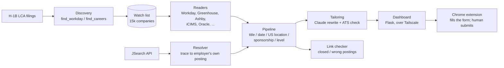

# Job Search Agent

An always-on agent that watches **15,000+ US employers' own careers sites**, finds new roles minutes after they are
posted, checks visa sponsorship and location, tailors a resume and cover letter for each posting with Claude, and
pre-fills the application for a human to review and submit.

I built it for my own job search. It runs 24/7 on a small Linux server, and I use it every day.

| | |
|---|---|
| Companies watched | 15,000+ (built from public H-1B LCA filings + automatic careers-site discovery) |
| Postings read per cycle | ~320,000, across all companies, every ~15 minutes |
| Time to detect a new posting | ~1 minute for companies hiring for the target role, ≤30 minutes for the rest |
| Job systems read directly | Workday, Greenhouse, Lever, Ashby, SmartRecruiters, Workable, Recruitee, BambooHR, Breezy, Pinpoint, Rippling, Oracle Cloud HCM, iCIMS, SAP SuccessFactors, Eightfold, Amazon, plus any careers page with schema.org `JobPosting` data |
| Tests | 99 automated tests (pytest) |

## How it works



1. **Discovery**: starts from employers in public H-1B LCA disclosure data, then finds each one's real careers system
   (Workday tenants via `robots.txt` site maps, other systems via API probes and careers-page parsing).
2. **Reading**: one reader per job system, with per-system pacing, back-off on 429s and strike-based skipping, so
   15k companies can be read without getting blocked.
3. **Filtering**: keeps only the target role, postings from the last 3 days (posting date from the source, and a
   "first read" rule for undated postings), US locations (remote roles only when open to the US), and drops
   postings that rule out visa sponsorship, using the posting text plus the employer's H-1B filing history.
4. **Source of truth**: postings seen on job sites are traced back to the employer's own careers page. Recruiters
   and aggregators are filtered out. A link checker re-opens every listed posting and moves closed ones out.
5. **Tailoring**: Claude rewrites the summary and the most relevant bullets in the posting's own wording. Every
   rewritten line is then **checked against the source resume**: any new number or any tool not in the master resume
   is rejected and the original bullet is kept. An ATS-style score (hard skills, title, experience, education,
   readability) is computed from the posting's own keywords.
6. **Review and apply**: a Flask dashboard (Today, New matches, insights, cover letters, application answers) and a
   Chrome extension that fills application forms from the dashboard's data. It never clicks Submit.

## Engineering notes

- **Memory-bounded on a 2 GB server**: bounded thread pools, descriptions dropped for jobs that are not kept, and
  systemd memory caps so the dashboard and VPN stay up even if the reader is killed.
- **Safe deploys**: `deploy/push.sh` sends code only; server data (jobs, resumes, keys) is never overwritten
  unless explicitly requested.
- **Private by default**: the dashboard is reachable only over Tailscale with HTTPS, plus basic auth and CSRF
  protection. Passwords for job portals are stored encrypted (`vault.py`).
- **No fabricated content**: generated resume lines go through fact checks before use; recruiters and closed
  postings are filtered out; the extension leaves final submission to a person.

## Stack

Python · Flask · SQLite · httpx · python-docx · Claude API · JSearch API · systemd · Tailscale · Chrome Extension (MV3) · pytest

## Run it

See [docs/SETUP.md](docs/SETUP.md). In short:

```bash
python3 -m venv .venv && source .venv/bin/activate
pip install -r requirements.txt
python -m pytest -q          # 99 tests
python pipeline.py --once    # one live cycle
python dashboard.py          # http://127.0.0.1:8000
```

`profile/` contains a fictional sample resume (Alex Rivera); replace it with your own via the dashboard.
